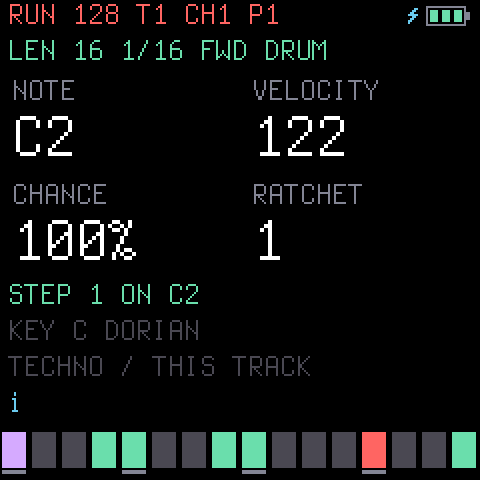

# SAGGA SEQ 0.17



SAGGA SEQ turns the M-VAVE FM-1 into a MIDI-only performance sequencer: 16 tracks, 8 patterns of up to 64 steps per
track, scenes, snapshots, a song, 16 LFOs, 16 keys, a library of 25 genres (a band of 8 to 11 parts each, 12
variations a part in order of likeness, notes of their own length), live Euclidean rhythms and four algorithm slots per
track, a harmony that the tracks follow (the genre's progressions or yours, on any root, with lengths in 16ths, pushes,
the genres' harmonic rhythms and ten moods; more of them, and more variations, kept by the Pi), chords and arpeggios from one note, six CC lanes with slides and NRPN, tools that wait for the bar or repeat
every so many, TAPE tracks and EXPO curves, the journey (every set cut into phrases; the MOSSE, PERF's third page,
queue moves for the phrase, the bar or the beat, and what you played becomes a song), BREAK tracks (a drum break in slices, sixteen chops on the white keys, re-ordered live),
TAKE and THROWS, every knob also set from the keys (PICK, from the grid too), the buttons' pages as windows a tap
opens (no button to hold), and a 16 x 8 grid made of two Launchpads through a Raspberry Pi, with five controller pages
for the Pi's RaspiMIDIHub.

**MIDI only.** SAGGA SEQ makes no sound: the FM-1's speaker and headphone output stay silent. It plays your synths
over USB MIDI (and listens on the TRS input). It cannot read the projects or samples of other FM-1 firmwares.

## Install

* **In the browser:** [The Firmware Hub](https://thefirmwarehub.com) (Chrome or Edge, FM-1 on USB): one click, and one
  click back to the official firmware or any other.
* **From a computer:** download `sagga-0.17.fwsc` (the `pacchetti` branch has every version) and run
  `python3 tools/fm1_install.py sagga-0.17.fwsc` (Python 3 and `mido` + `python-rtmidi`).
* To leave SAGGA SEQ, install another firmware the same way. If anything goes wrong, hold **OCT-** while switching
  the FM-1 on: the USB rescue always takes a new firmware.

The package identity is `FM-1_9` + (50 + the minor version): 0.9 is `FM-1_959`, 0.10 is `FM-1_960`, 0.11 is `FM-1_961`, 0.12 is `FM-1_962` ... 0.17 is `FM-1_967`.

## Docs

* [docs/SAGGA-SEQ.md](docs/SAGGA-SEQ.md): the reference (every control, the SysEx, the remote's CCs).
* [docs/SAGGA-GRID.md](docs/SAGGA-GRID.md): the grid, the bridge on the Pi, the snapshot patches.
* [docs/SAGGA-SEQ-0.17-INSTALL.md](docs/SAGGA-SEQ-0.17-INSTALL.md): install, update the Pi (Italian); [0.16](docs/SAGGA-SEQ-0.16-INSTALL.md), [0.15](docs/SAGGA-SEQ-0.15-INSTALL.md), [0.12](docs/SAGGA-SEQ-0.12-INSTALL.md).
* [docs/SAGGA-SEQ-0.12-DISEGNO.md](docs/SAGGA-SEQ-0.12-DISEGNO.md): the design 0.12 started from, and how it went (Italian).
* [docs/SAGGA-GRID-ZYNTHIAN.md](docs/SAGGA-GRID-ZYNTHIAN.md): the minimal stage set-up, the bridge on a Zynthian (Italian).
* [RELEASE-NOTES-0.17.md](RELEASE-NOTES-0.17.md): what changed (Italian); [0.16](RELEASE-NOTES-0.16.md), [0.15](RELEASE-NOTES-0.15.md), [0.14](RELEASE-NOTES-0.14.md), [0.13](RELEASE-NOTES-0.13.md), [0.12](RELEASE-NOTES-0.12.md), [0.11](RELEASE-NOTES-0.11.md), [0.10](RELEASE-NOTES-0.10.md), [0.9](RELEASE-NOTES-0.9.md), [0.8](RELEASE-NOTES-0.8.md).
* [tools/m8link/LEGGIMI.md](tools/m8link/LEGGIMI.md): two headless M8s on TrimUI Bricks as MIDI instruments for the
  Pi (Italian).

## What runs where

| | |
| --- | --- |
| FM-1 | the firmware: `firmware/` |
| Raspberry Pi with [RaspiMIDIHub](https://github.com/wamdam/raspimidihub) | the grid bridge (`tools/sagga_grid_bridge.py`), the remote and mutes plugins (`tools/raspimidihub/`), the M8 link's Pi side (`tools/m8link/pi/`) |
| TrimUI Brick with KNULLI | the M8 link's Brick side (`tools/m8link/brick/`) |

Everything on the Pi and the Bricks is optional: the FM-1 alone is a complete sequencer.

## Build

```sh
./build.sh --release 0.17         # identity FM-1_967
```

Needs the JieLi toolchain and the AC79 SDK (`tools/get_toolchain.sh`; `build.sh` says what is missing). Install with
`tools/fm1_install.py`.

## Test (no FM-1 needed)

```sh
sh tests/run_sagga_tests.sh                 # core, USB descriptors, bridge, plugins (RMH=...), simulator, fuzz, explorer
SANITIZE=1 FUZZ=60 sh tests/run_sagga_tests.sh
python3 tests/sagga_explore.py              # the explorer, all of it: every gesture in 11 situations, pairs, sessions
```

The explorer ([docs/SAGGA-ESPLORATORE.md](docs/SAGGA-ESPLORATORE.md), Italian) tries every gesture of the panel and the
grid from 11 starting situations, then pairs and long random sessions, and checks rules (browsing never changes the
harmony, nobody but HOME 1 K1 changes a channel, every track in time two bars later, no hung notes ...); it writes
what each gesture changes and how to repeat a broken rule.

## Project format

0.12 and 0.11 write `SGQB` (0.12 uses two of a track's reserved bytes for its BREAK settings) and read 0.10's `SGQA` too (a 0.10 project opens with the new things off); SGQ3 .. SGQ9 slots and
files are refused (keep a 0.9 firmware for 0.9 projects). The format carries the track settings (96 bytes a track: the
four algorithm slots, FOLLOW's way), five user progressions (roots, shapes, lengths, pushes, moods), 16 scenes, a song of 64 entries with a tempo
each, the snapshots (sparse), the project's id (the Pi keeps the snapshot patches by it) and a tail of tagged chunks,
so a later version can add data without a new format.

## USB

One USB-MIDI port by default (the grid on channels 15 / 16, the tracks on 1-14). USB PORTS 2 (the USB page, HOME +
SEL) gives two: port 1 the synths with 16 channels, port 2 the grid, the remote and the SysEx.

## Credits and licence

GPL-3.0-only (`LICENSE`). SAGGA SEQ stands on [Felucca](https://github.com/hugelton/Felucca) (Leo Kuroshita,
Hügelton Instruments), [SLOOP](https://github.com/isod89/sloop-fm1) (isod89) and Dinghy (zvenson): who made what is in
[LICENSING.md](LICENSING.md).
